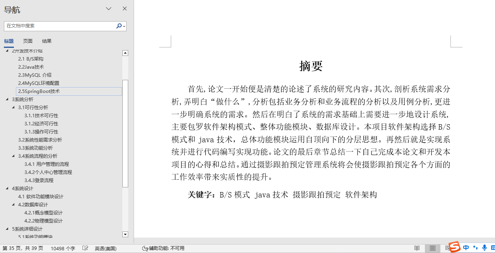
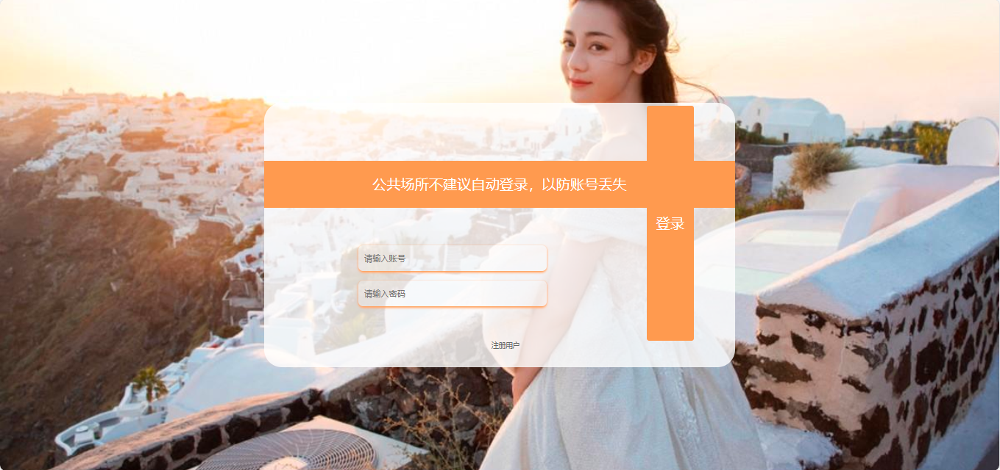
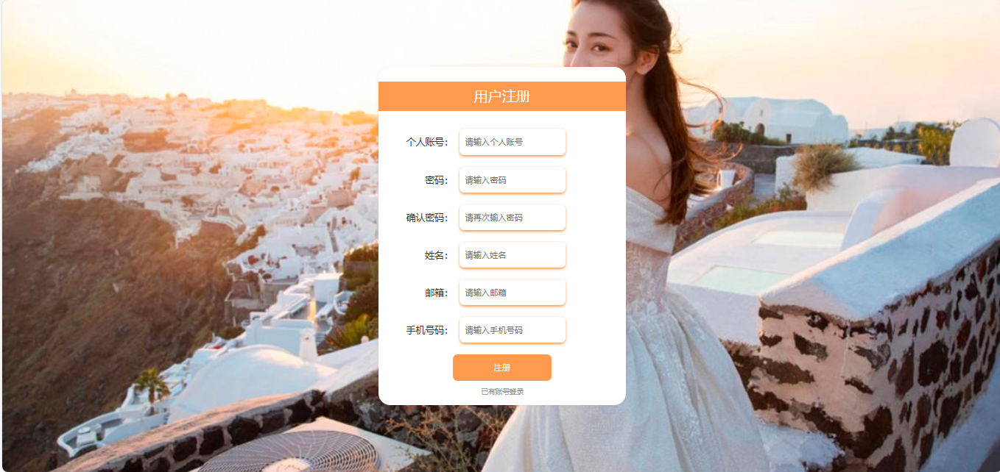
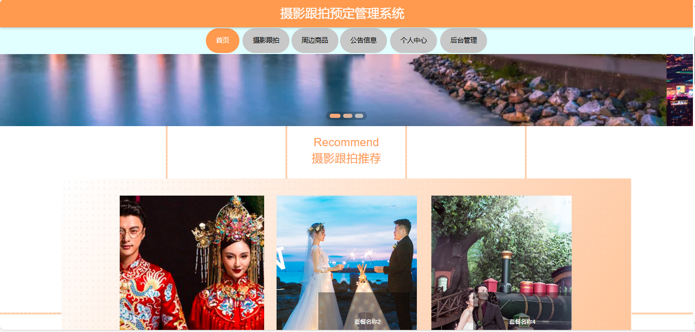
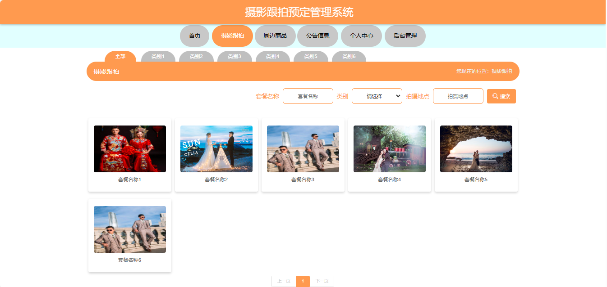
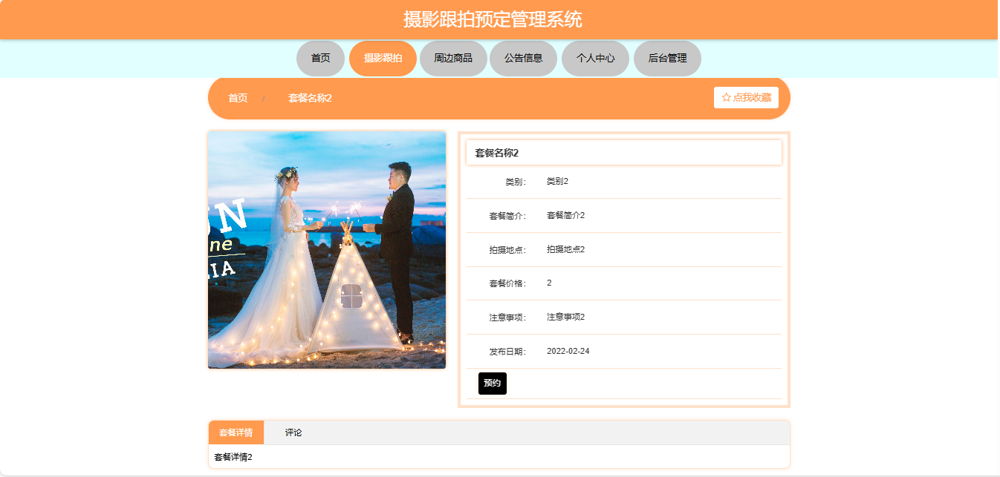
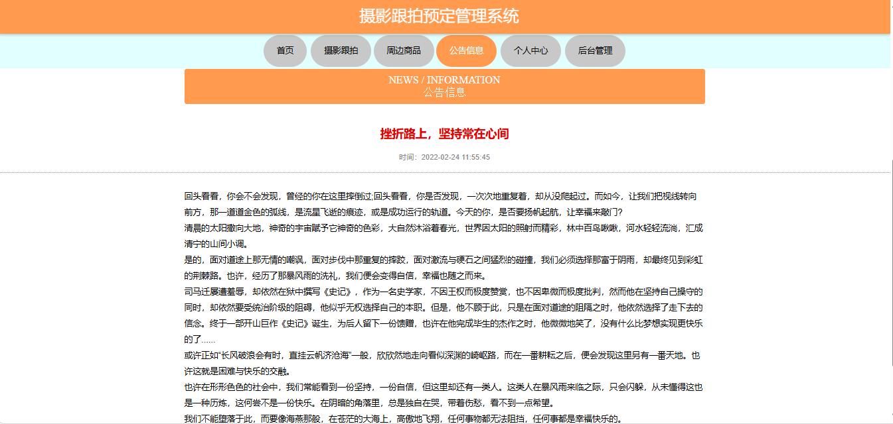
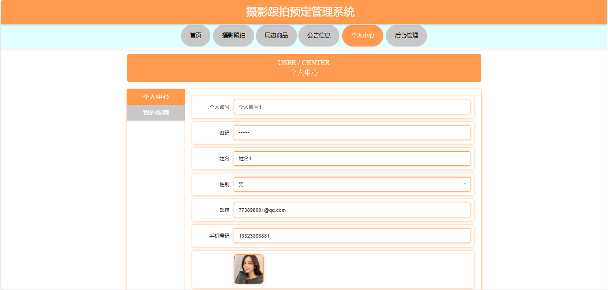
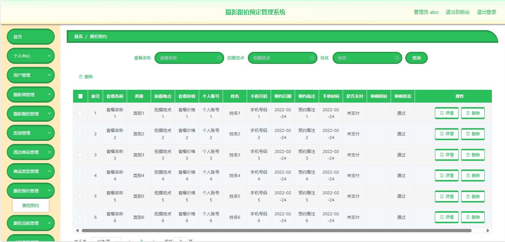
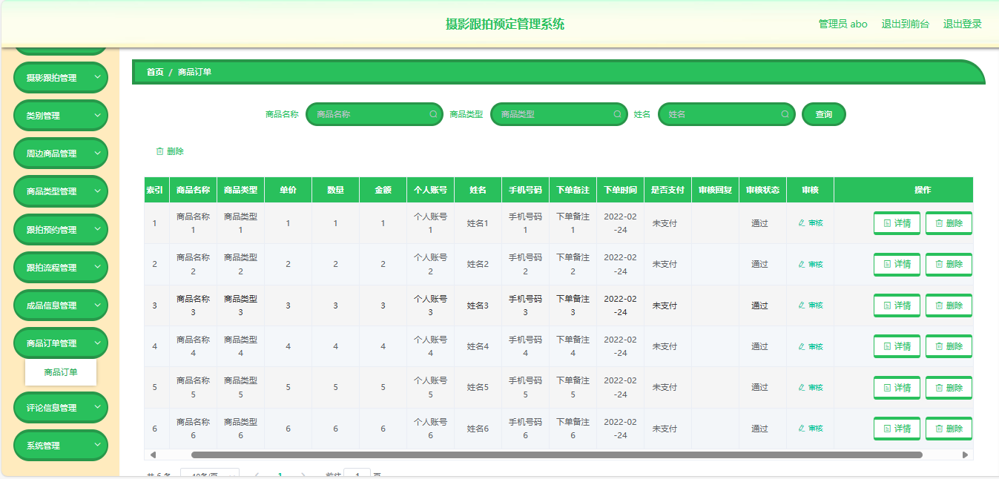

## 基于springboot的摄影跟拍预定管理系统(程序+报告)

###  获取完整源码和sql数据库文件（完全免费）:  微信: littlepinia88 qq：1104515926
###  所有项目以及源代码本人均调试运行无问题 可支持远程安装部署调试、定制修改、代码讲解

## 项目介绍

本项目是一个基于 Spring Boot 的摄影跟拍预定管理系统，面向摄影工作室的套餐销售、跟拍预约、拍摄流程安排、成品交付与周边商品售卖场景，采用「用户端静态页面 + 后台 Vue 管理端 + 后端 REST 接口」的前后端分离结构，打通了跟拍套餐浏览、在线预约下单、摄影师排期记录、成品上传、周边商品购买与评论互动的完整业务闭环。后端基于 Spring Boot + MyBatis-Plus 提供 JSON 接口，后台管理端使用 Vue2 + ElementUI 单页应用，用户端为 Layui + ElementUI 静态 HTML 页面，属于典型的 Java Web 前后端分离项目，可直接作为课程设计、毕业设计或 Spring Boot 入门实践案例。

### 系统角色
- **管理员**：登录后台管理端，维护用户、摄影师、跟拍套餐、类别、预约、流程、成品、周边商品、商品订单与评论公告。
- **普通用户**：注册并登录用户端，浏览跟拍套餐与周边商品、提交跟拍预约、购买周边商品、收藏与评论。
- **摄影师**：凭工号登录用户端，为已预约订单安排拍摄时间与流程内容，上传成品信息，并查看用户对自己的评分。
- **权限控制**：由 `AuthorizationInterceptor` 基于 Token 统一拦截，请求头携带 `Token`，登录成功后签发令牌并写入 `token` 表；标注 `@IgnoreAuth` 的登录、注册、公开列表与详情接口放行，其余接口需携带有效 Token。

### 用户端功能
1. **注册与登录**：用户填写个人账号、密码、姓名、性别、邮箱、手机号、头像注册，账号唯一校验；摄影师凭工号与密码登录，登录成功后后端签发 Token。
2. **跟拍套餐浏览**：分页展示摄影跟拍套餐（套餐名称、图片、类别、简介、拍摄地点、套餐价格、注意事项、发布日期），详情页查看图文套餐详情。
3. **跟拍预约**：用户选择套餐后填写预约日期、备注提交预约，记录下单时间；预约单带审核状态 `sfsh`、审核回复 `shhf` 与支付状态 `ispay`。
4. **跟拍流程与成品查看**：用户查看摄影师安排的拍摄时间与流程内容，以及摄影师上传的成品信息（成品名称、图片、附件、上传日期）。
5. **周边商品**：分页浏览周边商品（名称、商品类型、规格、单价、库存数量、产地、原材料），提交商品订单并填写备注，订单记录金额 `jine` 与支付状态。
6. **评论与收藏**：对跟拍套餐、周边商品发表评论；对感兴趣的套餐与商品执行收藏，收藏记录存于 `storeup` 表。
7. **个人中心**：用户与摄影师均可在个人中心修改本人资料与密码。

### 管理端功能
1. **管理员登录 / 注销**：管理员账号登录后台，登录态基于 Token 校验，支持退出。
2. **用户与摄影师管理**：对用户（`yonghu`）与摄影师（`sheyingshi`）分别进行分页查询、新增、编辑与删除。
3. **跟拍套餐管理**：维护套餐档案，支持封面上传，登记类别、拍摄地点、价格、注意事项与图文详情。
4. **类别与商品类型管理**：维护跟拍类别（`leibie`）与商品类型（`shangpinleixing`）字典。
5. **跟拍预约管理**：查看预约订单，执行审核（`sfsh`）并填写审核回复（`shhf`）。
6. **跟拍流程与成品管理**：查看摄影师排期的流程记录与上传的成品附件。
7. **周边商品管理**：维护商品档案（规格、单价、库存、产地、原材料），查看商品浏览量 `clicknum`。
8. **商品订单管理**：查看订单金额、数量与支付状态，执行审核与回复。
9. **评论管理**：管理评论信息（`pinglunxinxi`）与套餐、商品评论（`discusssheyinggenpai`、`discusszhoubianshangpin`）并回复。
10. **公告管理**：发布与维护系统公告。

### 技术栈
- **后端框架**：Spring Boot 2.2.2.RELEASE、Spring MVC，JDK 1.8
- **数据访问**：MyBatis-Plus 2.3（mybatis-spring-boot-starter 2.1.1），MySQL 数据库，Mapper XML 位于 `classpath*:mapper/*.xml`
- **前端**：管理端 Vue 2.6 + Element-UI 2.13 + Vue Router + Axios + ECharts（Vue CLI 4 构建）；用户端为 Layui + ElementUI 静态 HTML 页面
- **工程能力**：统一 `R` 响应模型、`AuthorizationInterceptor` Token 鉴权、`@IgnoreAuth` 注解放行、FastJSON、Hutool、Commons-IO 文件上传、POI 导入导出
- **构建运行**：Maven 构建，`spring-boot-maven-plugin` 打包；前端工程位于 `src/main/resources/admin/admin`，`npm run serve` 开发、`npm run build` 打包进 `dist`

### 核心数据表
- `yonghu` 用户表：个人账号 `gerenzhanghao`、密码 `mima`、姓名 `xingming`、性别、邮箱、手机号 `shoujihaoma`、头像 `xiangpian`
- `sheyingshi` 摄影师表：工号 `gonghao`、密码 `mima`、员工姓名 `yuangongxingming`、性别、邮箱、联系手机 `lianxishouji`、相片
- `sheyinggenpai` 摄影跟拍套餐表：套餐名称 `taocanmingcheng`、套餐图片 `taocantupian`、类别 `leibie`、套餐简介、拍摄地点 `paishedidian`、套餐价格 `taocanjiage`、注意事项 `zhuyishixiang`、发布日期 `faburiqi`
- `genpaiyuyue` 跟拍预约表：套餐名称、个人账号、姓名、手机号、预约日期 `yuyueriqi`、预约备注、下单时间 `xiadanshijian`、审核状态 `sfsh`、审核回复 `shhf`、支付状态 `ispay`
- `genpailiucheng` 跟拍流程表：安排时间 `anpaishijian`、流程内容 `liuchengneirong`、摄影师工号 `gonghao`、员工姓名、操作日期 `caozuoriqi`、审核状态
- `chengpinxinxi` 成品信息表：成品名称 `chengpinmingcheng`、成品图片 `chengpintupian`、成品附件 `chengpinfujian`、上传日期 `shangchuanriqi`、摄影师工号
- `zhoubianshangpin` 周边商品表：商品名称 `shangpinmingcheng`、商品类型 `shangpinleixing`、规格 `shangpinguige`、产地 `shengchandi`、原材料 `yuancailiao`、单价 `danjia`、数量 `shuliang`、点击量 `clicknum`
- `shangpindingdan` 商品订单表：商品名称、单价、数量、金额 `jine`、个人账号、下单备注、下单时间、审核与支付状态
- `pinglunxinxi` 评论信息表：摄影师工号、评价内容 `pingjianeirong`、评价日期 `pingjiariqi`
- `storeup` 收藏表：`userid`、`refid`、`tablename`、`name`、`picture`

### 工程结构
```
A015springboot808t0
├── src/main/java/com
│   ├── controller/     REST 控制器（用户、摄影师、套餐、预约、流程、成品、商品、订单、评论等）
│   ├── service/        业务接口与 impl 实现
│   ├── dao/            MyBatis-Plus Mapper 接口
│   ├── entity/         Entity/Model/View/VO 四层实体
│   ├── config/         InterceptorConfig、MybatisPlusConfig 等配置
│   ├── interceptor/    AuthorizationInterceptor Token 鉴权
│   ├── annotation/     IgnoreAuth 免登录注解
│   └── utils/          R、分页、文件、Token 等工具类
├── src/main/resources
│   ├── mapper/         MyBatis Mapper XML
│   ├── admin/admin/    后台 Vue2 + ElementUI 工程（src/views/modules + dist 打包产物）
│   ├── front/front/    用户端静态 HTML 页面（pages/ + layui + elementui）
│   ├── static/upload/  本地上传文件目录
│   └── application.yml  端口、上下文路径、数据源、MyBatis-Plus 配置
├── screenshot/         运行截图
└── pom.xml
```

### 访问入口
- 后台管理端（打包后）：`http://localhost:8080/springboot808t0/admin/admin/dist/index.html`
- 用户端首页：`http://localhost:8080/springboot808t0/front/front/index.html`
- 后台前端开发调试：`http://localhost:8081`（Vue CLI dev server，代理 `/springboot808t0` 到 8080）
- 后端接口前缀：`http://localhost:8080/springboot808t0`

### 补充说明
- 端口、上下文路径（`/springboot808t0`）与数据库连接均在 `src/main/resources/application.yml` 中配置（默认库 `a015_springboot808t0`，root/123456），首次运行需按本机 MySQL 调整账号密码并先导入 SQL 脚本建表。
- 密码以明文形式入库，登录后仅以 Token 标识身份，未引入权限框架；预约与订单的支付 `ispay` 仅为状态标记，未接入真实支付渠道。
- 成品附件与商品图片均保存在本地磁盘 `static/upload/`，部署时需保证目录可写。

## 运行环境
- JDK版本：JDK1.8及以上
- 开发工具：IDEA、Ecplise、Myecplise都可以
- 数据库: MySQL5.7及以上
- Node：14.14.0及以上

## 运行截图



















